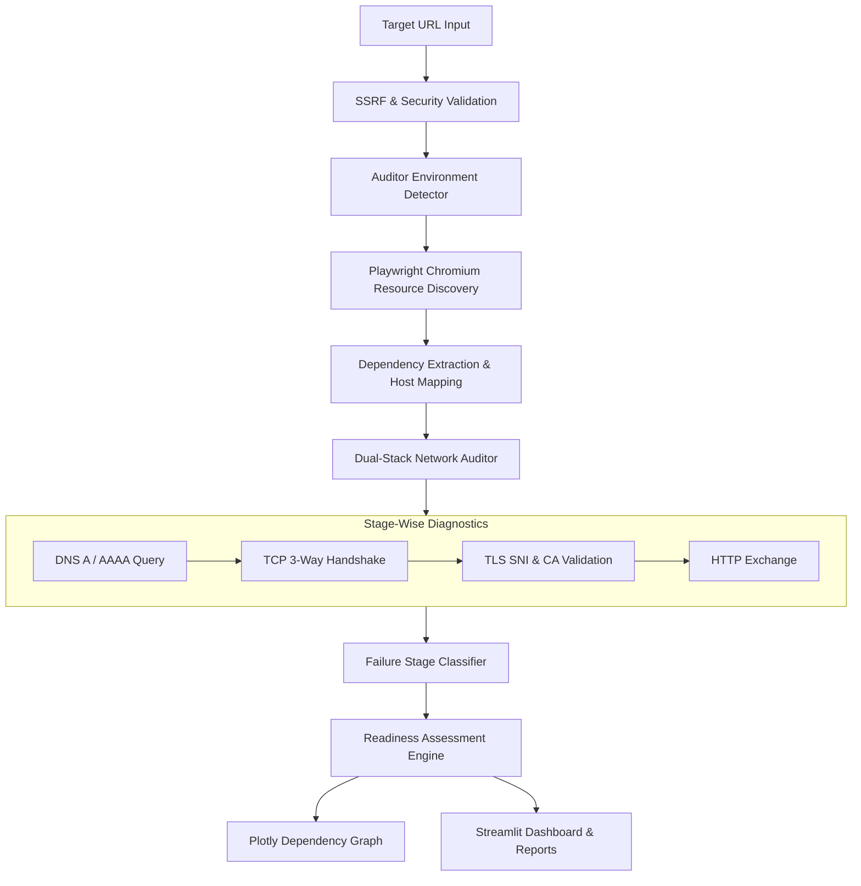

# 🌐 IPv6 Website and Dependency Readiness Auditor

**Team:** First_Timers  
**Members:** Nachan HaazalAli Danish & Eshaan Brahmi  
**Hackathon:** AIORI Hackathon 3  
**Project ID:** `A3-PS027-TC108`  
**Date:** October 2026  

---

## 📌 Executive Summary & Problem Statement

Modern websites depend on complex ecosystems of external resources — CDNs, analytics endpoints, fonts, API microservices, stylesheets, and third-party scripts. 

A conventional DNS check examining only the root domain (`example.com`) provides a false sense of security:
> **The core domain may publish an IPv6 `AAAA` record, while critical page dependencies remain IPv4-only or fail to negotiate IPv6 transport.**

When an IPv6-only client attempts to access the service, sub-resources fail to load, breaking layouts, scripts, and user workflows. 

The **IPv6 Website and Dependency Readiness Auditor** solves this by:
1. Loading the target webpage in an automated **Playwright Chromium** browser session.
2. Intercepting and discovering all first-party and third-party dependencies.
3. Conducting **stage-wise empirical network tests**: Dual-Stack DNS (`A`/`AAAA`), genuine TCP handshakes, strict TLS/SNI certificate verification, and HTTP response exchanges.
4. Categorizing failures by exact network stage (DNS vs. TCP vs. TLS vs. HTTP vs. Browser).
5. Generating an interactive **Dependency Readiness Graph**, transparent scoring, and downloadable JSON/CSV/HTML reports.

---

## 🚀 Key Features

- **Automated Browser Dependency Discovery:** Headless Chromium captures all active scripts, stylesheets, images, fonts, and fetch/XHR calls.
- **SSRF and Input Hardening:** Blocks loopback addresses (`127.0.0.1`, `::1`), private ranges (RFC 1918), link-local (`169.254.0.0/16`, `fe80::/10`), multicast, and cloud metadata endpoints (`169.254.169.254`).
- **Stage-Wise Diagnostic Engine:**
  - **DNS:** Measures resolution latency and tests both `A` and `AAAA` records.
  - **TCP:** Genuine 3-way handshakes over `AF_INET` and `AF_INET6`.
  - **TLS:** Full certificate validation and SNI negotiation without bypassing CA checks.
  - **HTTP:** Bounded `HEAD`/`GET` requests with status code categorization.
- **Environment Disambiguation:** Checks local host IPv6 capabilities at startup, distinguishing target failures from host network routing limitations.
- **Interactive Visualizations:** Plotly dependency graph with node status color-coding and resource inspection.
- **Comprehensive Reports:** Instant export to JSON, CSV, and standalone HTML reports.
- **Historical Comparison:** Compare multiple audit runs in session memory to track regression or dependency changes.

---

## 🛠️ Technology Stack

| Layer | Component | Description |
| :--- | :--- | :--- |
| **Language** | Python 3.12+ | Core application runtime |
| **Dashboard UI** | Streamlit 1.38+ | Modern dark cybersecurity UI |
| **Browser Engine** | Playwright Chromium | Network request interception & DOM execution |
| **DNS Resolver** | dnspython 2.6+ | Low-level `A` and `AAAA` record inspection |
| **Networking** | `socket`, `ssl`, `http.client` | Native Python transport layer measurements |
| **Visualization** | Plotly & NetworkX | Interactive dependency ecosystem graph |
| **Data Processing**| Pandas | Tabular resource filtering and formatting |
| **Automated Testing**| Pytest | Comprehensive unit and integration test suite |

---

## 🏛️ System Architecture



---

## 📦 Installation & Setup

### 1. Clone the Repository
```bash
git clone https://github.com/First_Timers/ipv6-readiness-auditor.git
cd ipv6-readiness-auditor
```

### 2. Set Up Virtual Environment

**On Windows (PowerShell):**
```powershell
python -m venv .venv
.\.venv\Scripts\Activate.ps1
```

**On Linux / macOS:**
```bash
python3 -m venv .venv
source .venv/bin/activate
```

### 3. Install Dependencies
```bash
pip install -r requirements.txt
```

### 4. Install Playwright Chromium Browser
```bash
python -m playwright install chromium
```

---

## 🖥️ Running the Application

Launch the Streamlit dashboard:
```bash
streamlit run app.py
```
Or with explicit host/port:
```bash
python -m streamlit run app.py --server.port 8501
```

Open your browser at `http://localhost:8501`.

---

## 🧪 Running the Test Suite

Run all automated unit and integration tests using pytest:
```bash
pytest tests/ -v
```

All 26 tests cover:
- URL validation, normalization, and SSRF filtering
- DNS A and AAAA record analysis and resolution error handling
- TCP socket handshake latency, refusal, and timeout handling
- Failure classification logic and evidence compilation
- Dual-stack readiness scoring calculations
- JSON, CSV, and HTML report generation

---

## 📖 Audit Methodology & Scoring

Readiness is evaluated through a transparent, 4-stage formula (0 to 100 points):

$$\text{Readiness Score} = S_{\text{Main-DNS}} + S_{\text{Main-Conn}} + S_{\text{Dep-DNS}} + S_{\text{Dep-Conn}}$$

- **Main Host AAAA DNS (25 pts):** Main root domain has valid `AAAA` records.
- **Main Host Connectivity (25 pts):** Main domain successfully establishes IPv6 TCP/TLS sessions.
- **Dependency AAAA Adoption (25 pts):** Ratio of third-party domains with `AAAA` records.
- **Dependency Live IPv6 Connectivity (25 pts):** Ratio of dependencies successfully reachable over IPv6.

For full technical details, consult [`docs/methodology.md`](docs/methodology.md) and [`docs/architecture.md`](docs/architecture.md).

---

## 🔒 Security & Safe Auditing

The auditor implements defensive controls to ensure it cannot be misused:
- **Private Subnet Blocking:** Rejects targets resolving to `10.0.0.0/8`, `172.16.0.0/12`, `192.168.0.0/16`, `127.0.0.0/8`, `::1`, and `fe80::/10`.
- **Cloud Metadata Defense:** Blocks queries directed at `169.254.169.254`.
- **Bounded Requests:** Restricts responses to 32 KB and only issues safe `HEAD` or read-only `GET` requests (no state-changing `POST`/`PUT`/`DELETE` calls).
- **Certificate Integrity:** Never disables SSL certificate verification.

---

## ⚠️ Known Technical Limitations

- **Auditor Host Limitations:** When run on an IPv4-only ISP or VM without an active IPv6 default route, the host operating system returns `Network unreachable (WinError 10051 / ENETUNREACH)`. The application automatically flags this as an *Auditor Host Limitation* rather than mislabeling the target website as broken.
- **Dynamic User-Triggered Assets:** Resources rendered only after user interactions (e.g. infinite scrolls, logins) are not captured in an initial page load.

See [`docs/limitations.md`](docs/limitations.md) for deeper analysis.

---

## 📚 References & Standards

- [IETF RFC 8200 — Internet Protocol, Version 6 (IPv6) Specification](https://datatracker.ietf.org/doc/html/rfc8200)
- [IETF RFC 8305 — Happy Eyeballs Version 2: Better Connectivity Using Concurrency](https://datatracker.ietf.org/doc/html/rfc8305)
- [Playwright Python Documentation](https://playwright.dev/python/docs/intro)
- [Streamlit Documentation](https://docs.streamlit.io/)
- [MDN Web Docs — Resource Loading and Timing](https://developer.mozilla.org/en-US/docs/Web/API/Resource_Timing_API)

---

## 📄 License

This project is licensed under the [MIT License](LICENSE).  
Copyright (c) 2026 Team First_Timers (Nachan HaazalAli Danish, Eshaan Brahmi).
