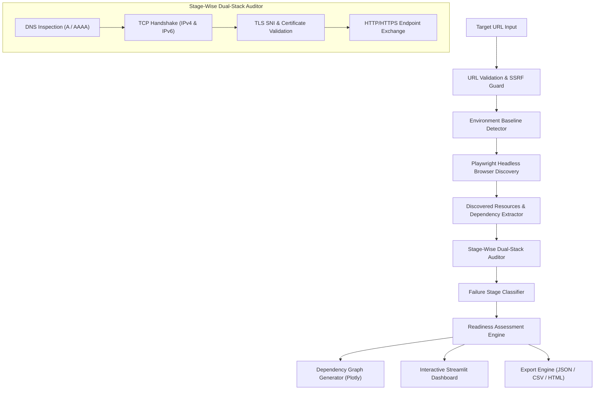

# System Architecture & Design

**Project:** IPv6 Website and Dependency Readiness Auditor  
**Team:** First_Timers (Nachan HaazalAli Danish, Eshaan Brahmi)  
**Hackathon:** AIORI Hackathon 3  
**Project ID:** A3-PS027-TC108  

---

## 1. High-Level Architecture Overview

The IPv6 Website and Dependency Readiness Auditor is designed with a decoupled, multi-tier pipeline that transitions a user-supplied target URL into observable network artifacts, stage-wise measurements, failure classifications, and visual reports.

---

## 2. Component Breakdown

### 2.1 Input Validation and SSRF Defense (`auditor/url_validation.py`)
- **Strict Scheme Enforcement:** Only `http` and `https` schemes are accepted.
- **SSRF Prevention:** All target hostnames and resolved IP literals are evaluated against `ipaddress.is_loopback`, `ipaddress.is_private`, `ipaddress.is_link_local`, `ipaddress.is_multicast`, and cloud metadata addresses (`169.254.169.254`).
- **Safe Normalization:** Standardizes paths and trims fragments to ensure consistent DNS and HTTP lookups.

### 2.2 Environment Baseline Detector (`auditor/network_checker.py`)
- **Auditor Stack Inspection:** Probes public dual-stack resolvers (Google DNS `8.8.8.8` / `2001:4860:4860::8888`, Cloudflare `1.1.1.1` / `2606:4700:4700::1111`) to detect whether the host running the auditor has active outbound IPv4 and IPv6 routing.
- **Environment Disambiguation:** Distinguishes between target incompatibility and local host network restrictions (e.g. host lacking a default IPv6 internet route).

### 2.3 Headless Browser Dependency Discovery (`auditor/browser_discovery.py`)
- **Playwright Chromium Engine:** Spins up a headless Chromium instance to navigate to the target site, capturing real-time network traffic (`request`, `response`, `requestfailed`).
- **Resource Classification:** Tags assets into scripts, stylesheets, images, fonts, fetch/XHR, documents, and media.
- **First-Party vs Third-Party:** Employs domain boundary heuristics to segment origin infrastructure from external third parties.
- **Resilient Fallback:** Provides static HTML parsing fallback if browser drivers are restricted in the runtime environment.

### 2.4 Stage-Wise Network Testing Suite
- **DNS Checker (`auditor/dns_checker.py`):** Uses `dnspython` to query `A` and `AAAA` records, measuring resolution latency in milliseconds and distinguishing missing records (`NODATA`) from NXDOMAIN and timeouts.
- **TCP Checker (`auditor/network_checker.py`):** Initiates raw socket connections (`AF_INET` / `AF_INET6`) to target endpoints, capturing round-trip handshake latency or connection refusal (RST).
- **TLS Checker (`auditor/tls_checker.py`):** Establishes TLS sessions with strict CA certificate validation while preserving the original hostname in Server Name Indication (SNI). Distinguishes expired/invalid certificates from transport breaks.
- **HTTP Checker (`auditor/http_checker.py`):** Issues safe `HEAD` and bounded `GET` requests to resolved target IPs, recording HTTP status codes, redirection hops, and protocol responses.

### 2.5 Failure Stage Classifier (`auditor/failure_classifier.py`)
- Maps observed anomalies into unambiguous layers:
  1. `DNS Resolution Failure` / `Missing IPv6 AAAA Record`
  2. `Testing Environment Limitation`
  3. `TCP Connection Error`
  4. `TLS Certificate Validation Error` / `TLS Handshake Error`
  5. `HTTP Client/Server Error`
  6. `Browser Asset Load Failure`

### 2.6 Readiness Assessment Engine (`auditor/readiness_assessment.py`)
- Synthesizes findings into standardized readiness categories:
  - *IPv6 connectivity verified for tested endpoints*
  - *Partial IPv6 readiness*
  - *IPv6 compatibility concerns detected*
  - *IPv6 testing inconclusive*
  - *Insufficient evidence to determine readiness*
- Calculates a weighted readiness score (0 to 100%) split evenly across Main Host DNS (25%), Main Host Connectivity (25%), Dependency DNS Adoption (25%), and Dependency Connectivity (25%).

### 2.7 Interactive Visualization and Reporting
- **Dependency Graph (`auditor/dependency_graph.py`):** Uses NetworkX spring layout and Plotly Scatter graph to visualize root-to-dependency relationships with color-coded status states.
- **Report Generator (`auditor/report_generator.py`):** Exports structured JSON records, tabular CSV resource lists, and self-contained HTML audit reports.
