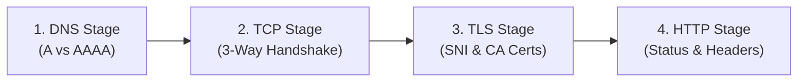

# Audit Methodology & Measurement Standards

**Project:** IPv6 Website and Dependency Readiness Auditor  
**Team:** First_Timers (Nachan HaazalAli Danish, Eshaan Brahmi)  
**Hackathon:** AIORI Hackathon 3 | Project ID: A3-PS027-TC108  

---

## 1. Core Principles

Modern web applications depend heavily on third-party CDNs, analytics providers, font libraries, and APIs. A primary domain may resolve an IPv6 address, yet the page can still fail for IPv6-only clients if critical dependencies fail to load over IPv6.

This auditor evaluates websites using empirical, stage-wise measurements governed by foundational Internet standards:
- **IETF RFC 8200:** Internet Protocol, Version 6 (IPv6) Specification.
- **IETF RFC 8305:** Happy Eyeballs Version 2 (dual-stack connection behavior).

---

## 2. Stage-Wise Diagnostic Pipeline

### Stage 1: DNS Record Availability & Latency
- Every discovered host is independently queried for `A` (IPv4) and `AAAA` (IPv6) records.
- **Resolution Categories:**
  - `IPv4 DNS available`: At least one valid IPv4 address returned.
  - `IPv6 DNS available`: At least one valid IPv6 address returned.
  - `IPv6 DNS unavailable`: Host exists and responds to `A` queries, but returns zero `AAAA` records (`NODATA`).
  - `DNS resolution error`: Nameserver returns `NXDOMAIN` (domain does not exist) or `SERVFAIL`.
  - `DNS test inconclusive`: Query timed out before nameserver responded.

### Stage 2: Genuine TCP Handshake
- For endpoints with IP addresses, a non-blocking TCP socket (`socket.AF_INET` or `socket.AF_INET6`) attempts connection to destination port 80 or 443 with a 4.0-second timeout.
- Handshake completion confirms network layer and transport layer reachability.
- `RST` packets are flagged as `Connection Refused`.

### Stage 3: Strict TLS Handshake & SNI Preservation
- For HTTPS endpoints, TLS negotiation is performed directly against the resolved IP while strictly setting the `server_hostname` in SNI.
- Certificates are validated against system and standard Mozilla CA bundles (`certifi`).
- Certificate expirations or common-name mismatches are explicitly distinguished from transport-level drops.

### Stage 4: HTTP Request & Response Verification
- Bounded HTTP `HEAD` (or `GET` with a 32 KB safety cap) requests are dispatched.
- HTTP status codes (2xx, 3xx redirects, 4xx client errors, 5xx server errors) are recorded.

---

## 3. Transparent Readiness Scoring Formula

To avoid subjective scores, readiness is calculated using an objective 4-part model:

$$\text{Readiness Score} = S_{\text{Main-DNS}} + S_{\text{Main-Conn}} + S_{\text{Dep-DNS}} + S_{\text{Dep-Conn}}$$

| Metric | Weight | Condition |
| :--- | :--- | :--- |
| **Main Host AAAA DNS** ($S_{\text{Main-DNS}}$) | **25%** | $25$ pts if main host has valid `AAAA` record; $0$ pts if missing |
| **Main Host IPv6 Connectivity** ($S_{\text{Main-Conn}}$) | **25%** | $25$ pts if IPv6 TCP/TLS handshake succeeds ($25$ pts if DNS verified and host is environment-limited) |
| **Dependency AAAA Adoption** ($S_{\text{Dep-DNS}}$) | **25%** | $\frac{\text{Dependencies with AAAA}}{\text{Total Dependencies}} \times 25$ pts |
| **Dependency Live IPv6 Connectivity** ($S_{\text{Dep-Conn}}$) | **25%** | $\frac{\text{Dependencies with IPv6 Live Connect}}{\text{Total Dependencies}} \times 25$ pts |

### Categorization Tiers
- **IPv6 connectivity verified for tested endpoints:** Main domain and all tested dependencies successfully resolve and connect over IPv6.
- **Partial IPv6 readiness:** Main website supports IPv6, but one or more third-party dependencies are IPv4-only.
- **IPv6 compatibility concerns detected:** Target main website lacks an IPv6 `AAAA` record or exhibits severe protocol failures.
- **IPv6 DNS verified (Auditor Environment Limited):** Target has valid AAAA DNS, but auditor host lacks outbound IPv6 routing.
